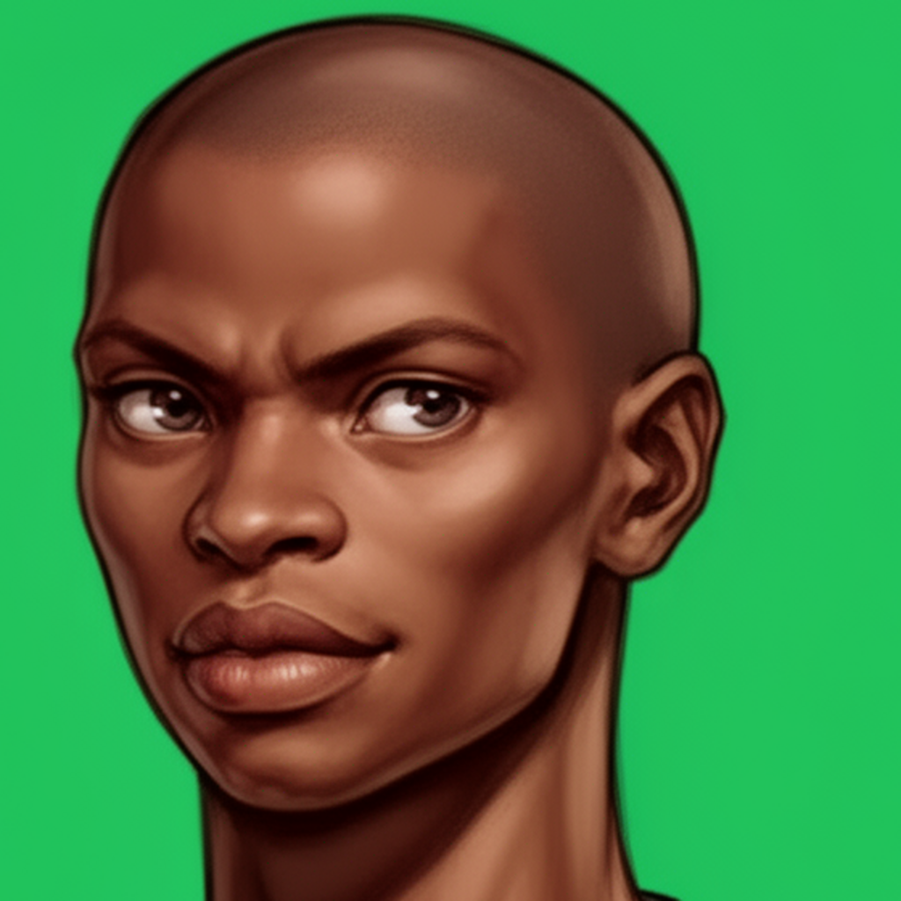
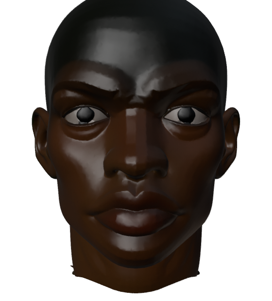

# Generating assets with AI

The **Assets** mode can make a 3D prop from a sentence: an image model draws it, you choose the
best drawing, a reconstruction model turns that picture into a textured mesh, and the asset service
finishes the mesh for the game (simplified and compressed). The same service generates tileable
materials for roads, ground and buildings.

| Piece | Model | What it does |
|---|---|---|
| asset service (`services/assetsvc`) | | the catalog, the job queue, and finishing; the editor talks only to it |
| image model | FLUX.2 (`flux.2-dev`) | draws views of a prop, and texture maps |
| mesh model | TRELLIS.2, behind the `recon` service | turns one picture into a textured `.glb` |

Without the AI endpoints everything else still works: the catalog, importing your own `.glb`
files, placing things, baking worlds. Drawing and meshing say the model is not configured.




*One picture in, a mesh out: a portrait and the head TRELLIS.2 reconstructed from it.*

## Making a prop

In **Assets → Catalog**:

1. **New item**: a name (the id is derived from it) and a class (vehicle, building, sign, a new
   class of your own...). Then **Create**.
2. **1 · Described**: the subject, the real size in metres (height, length, width), the
   orientation, a **Prompt** and what to **Avoid**. **Save changes**.
3. **2 · Drawn**: **Draw** (then **Draw another**) makes views. Set a **seed** to draw the same
   thing again, which is how you tell a prompt change from a different roll. Click a view to see
   it full size; **Mesh this** on the view you want.
4. **3 · Meshed**: the reconstruction appears in a 3D viewer (spin, wireframe, **Pop out**). Meshing
   takes a minute or two; jobs run one at a time, so a queue shows its position.
5. Tick **placeable in worlds** to put it in Place mode's palette.

**Import a model** adds a `.glb` you already have, with no AI involved.

**Materials** works the same way for textures: describe the material and its real-world scale
(metres per tile); a generated set arrives as a draft you can inspect on a sample wall and then
**Save the new one** or **Discard it**. **Upload maps** takes your own albedo, normal and roughness
images.

**Tips that hold for FLUX.2:** it tends to crop tall subjects at the bottom of the frame whatever
the prompt says, so ask for the subject small in frame or generate a tall part on its own.
Proportions come from what the subject is called more than from the numbers in the prompt. For
meshing, a saturated, flatly lit view of the whole object works best.

## Where the models run

The asset service holds only URLs, so the models can be anywhere. Choose one:

### Your own GPUs, with the provided compose file

`deploy/docker/ai/docker-compose.yml` runs FLUX.2 and TRELLIS.2 on one GPU each (an 80 GB-class
card each), on the same machine as the main stack or another:

```bash
cd deploy/docker/ai
cp .env.example .env                  # HF_TOKEN, FLUX_GPU, TRELLIS_GPU, AI_API_KEY
docker compose --profile gateway up -d
```

- FLUX.2-dev is a gated model: accept its licence on Hugging Face and set `HF_TOKEN`. About 64 GB of
  weights are downloaded on first start.
- The `gateway` profile puts both behind one port (8443) that requires
  `Authorization: Bearer $AI_API_KEY`. Without it, the models listen on the AI host's 127.0.0.1
  only.

Then point the main stack at it, in `deploy/docker/.env`:

```bash
PIEDMONT_IMAGE_MODEL_URL=http://<AI host address>:8443/flux
PIEDMONT_MESH_MODEL_URL=http://<AI host address>:8443/trellis
PIEDMONT_IMAGE_MODEL_KEY=<the same key>
PIEDMONT_MESH_MODEL_KEY=<the same key>
```

and run `docker compose up -d` there. Use the AI host's network address even when it is the same
machine: inside the main stack, `localhost` is the stack itself.

> This AI stack has been validated statically but not yet run end to end. The exact vLLM arguments
> for FLUX.2 may need adjusting for your card: check `curl :18090/v1/models` and one generation.

### On Kubernetes

The `recon` chart runs TRELLIS.2 on a GPU node. The `assetsvc` chart carries a model roster
(`models` in its values) whose URLs point at your image and mesh endpoints; any one can be
overridden with `ASSETSVC_URL_<ID>` (for example `ASSETSVC_URL_FLUX2_DEV`).

### A hosted provider

- **Images:** any endpoint that speaks the OpenAI images API (`/v1/images/generations` and
  `/v1/images/edits`) can stand in. It must accept the model id `flux.2-dev`, or change the
  roster entry's `model` to the provider's id.
- **Meshes:** the mesh API is piedmont's own (`POST /reconstruct`, `GET /jobs/<id>`,
  `GET /jobs/<id>/asset`), so a different reconstruction service needs a thin adapter in front of it.

A key in `PIEDMONT_IMAGE_MODEL_KEY` / `PIEDMONT_MESH_MODEL_KEY` is sent as a bearer token.

## Checking it

**Assets → Service** shows which models are configured and which answer. From a shell:

```bash
curl -s <editor>/assetsvc/models
```

The editor proxies the asset service at `/assetsvc/`, so the browser and agents never need to
reach it, or the GPUs, directly. The full service reference, with every endpoint and setting, is
[services/assetsvc/README.md](../../services/assetsvc/README.md).

## Over MCP

An agent can run the same pipeline: `asset_describe`, `asset_draw`, `asset_view` (to look at a
drawing before meshing it), `asset_choose`, `asset_mesh` and `asset_job`, plus
`material_draft` / `material_save` / `material_discard` for textures. See the [MCP guide](mcp.md).
